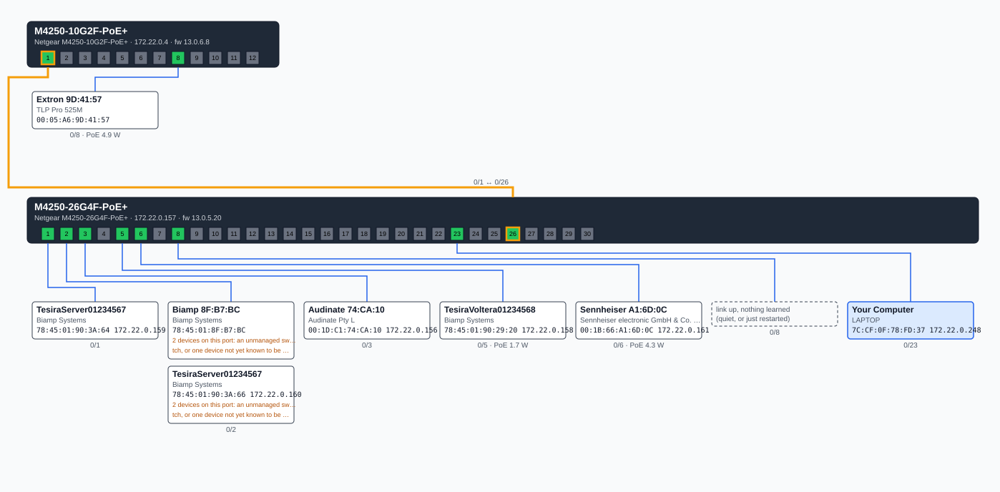

# netdiagram

Finds the managed switches on a network, logs into the ones you choose, reads their LLDP
neighbors, MAC tables, ports and PoE, and draws how the switches and devices connect. It is
**read-only on every switch**: it can only send `show` commands from a fixed allowlist, plus
`enable` (Netgear) or `terminal datadump` (Cisco) to set up its own session, which change no
configuration.

Supported switches:

- **Netgear M4250 / M4350** (Telnet). Built and tested against a real M4250.
- **Cisco Catalyst 1300 / CBS350** (SSH). The parsers are built from the examples in
  Cisco's CLI guide and haven't been run against a real switch yet. Reports from one are
  welcome.

Written in Go. The browser interface and logins need Windows, because logins are kept in
Windows Credential Manager. Parsing and drawing from saved output run anywhere.



## Requirements

- **[pinger](https://github.com/JaimeMaertz/pinger)**, from its release zip, on PATH or in the
  same folder as `netdiagram.exe`. netdiagram runs `pinger -json` to sweep the subnet, and reads
  `oui.txt` (manufacturer names) and `devices.json` (your device names, optional) from beside
  pinger. Without `oui.txt` the map still draws, with blank manufacturers, and netdiagram prints
  a warning.
- To build from source: Go 1.26 or later.
- Telnet (Netgear) or SSH (Cisco) enabled on the switch, and a login with privileged access.

## Use it

Double-click `netdiagram.exe`, or run it with no arguments. It starts a local server on
`127.0.0.1:8765` and opens your browser:

1. **Scan.** The subnets default to a /24 around each of your PC's adapters. The scan lists
   every Netgear, Cisco or Aruba host with its SSH, Telnet, web and HTTPS ports. A switch is
   ticked when it's readable (Netgear or Cisco with Telnet or SSH open).
2. **Read.** For a ticked switch with no saved login, netdiagram asks for one and saves it
   to Credential Manager as `netdiagram:<switch MAC>`, then reads every ticked switch. The
   scan's MAC-to-IP pairs give IPs to devices the switch's own ARP table doesn't know, and
   the PC you're running from is drawn as "Your Computer".
3. **Map.** You get the diagram and a device table. Each read is saved as a snapshot in
   `Documents\netdiagram\<date_time>.json`, and saved snapshots reopen from the list without
   logging in. **Save diagram** downloads the SVG. Each switch's raw output is also kept, in
   `raw\<ip>_<date_time>\` beside the snapshots. If a parser can't read it (for example, a
   firmware that lays a table out differently), the read stops and names that folder.

The server only answers calls that carry the token it creates at each start (it's in the
URL the browser opens), so no other web page can use it to save logins or read switches.
Close the console window to stop it.

### Command line

```
netdiagram discover -host 172.22.0.4 -cred netdiagram:<MAC> -out site.json   (repeat -host/-cred per switch)
netdiagram discover -host 172.22.0.4 -from saved-output\ -out site.json      (saved output, any OS)
netdiagram draw site.json -o site.svg
netdiagram version
```

| `discover` option | Meaning                                                           |
| ----------------- | ----------------------------------------------------------------- |
| `-host`           | switch address (repeat for each switch)                           |
| `-cred`           | Credential Manager target holding that switch's login (Windows)   |
| `-from`           | folder of saved command output, instead of logging in             |
| `-vendor`         | `Netgear` or `Cisco` when logging in (with `-from` it's detected) |
| `-out`            | snapshot file to write                                            |
| `-raw`            | also save each switch's raw output under this folder              |
| `-db`, `-oui`     | device database and manufacturer list, if not pinger's            |

To save a login without the browser: `cmdkey /generic:netdiagram:<MAC> /user:<name> /pass`.
The password is never printed or written to a file.

## How the map is worked out

- **Switch-to-switch links.** A port is a link when its LLDP neighbor is another switch that
  was read (matched by MAC, management IP or name), when the neighbor is a bridge or router
  that wasn't read, or when another read switch's own MAC is learned on that port.
- **Placement.** Each device MAC goes on its one non-uplink port. A MAC seen only on uplinks
  is placed on the uplink and marked as beyond a switch that wasn't read.
- **Grouping.** AV devices often have several MACs (a control port and a Dante port, for
  example). The MACs on one port count as one device when the database gives them the same
  name and job site, or when they're in the same manufacturer block and at most 8 apart. The
  second case is drawn as a "likely" group, since it's unconfirmed. Virtual machine MACs
  (VirtualBox, VMware, Hyper-V, QEMU) are separate devices. When two or more devices share
  one port, the port gets a note: there's an unmanaged switch there, or a device that isn't
  yet known to be one.
- **Names.** From your device database first (a group takes the common start of its names,
  so `Rack-Tesira` and `Rack-Tesira-Dante` become `Rack-Tesira`), then the LLDP system name
  or chassis ID, then the manufacturer and the MAC's last three bytes. A switch listed in
  the database is titled by its database name.
- **IPs.** From the switch's ARP table, then LLDP management addresses, then the sweep.

In the drawing, each switch is a box with its ports (green up, grey down), and each used
port has a column of devices under it, labelled with the port and its PoE draw. Wires are
routed so they don't cross where that can be avoided. Dashed boxes are "likely" groups,
dotted boxes are VMs, and the blue box is your computer. A link between two read switches is
an orange line between the two ports.

## Build and test

```
go test ./...                                    # parsers, the map and the drawing, on testdata/
cmd /c "go test ."                               # on Windows: adds the Credential Manager round trip
GOOS=windows go build -o netdiagram.exe ./cmd/netdiagram
GOOS=windows go build -o probe.exe ./cmd/probe
```

`probe` logs into one switch (`-vendor Netgear|Cisco`), runs every allowlisted command and
saves each output raw to a folder. That's how test fixtures are made, and it's the most
useful thing to send if a switch's output doesn't parse.

## Source layout

| Path                     | What it holds                                                                                                   |
| ------------------------ | --------------------------------------------------------------------------------------------------------------- |
| `cmd/netdiagram/`        | the program: the local server and its API, `discover` and `draw`, and the web page (`web/index.html`, embedded) |
| `cmd/probe/`             | saves one switch's raw output, for fixtures                                                                     |
| `scan.go`                | runs pinger's sweep, finds switch makers, probes their ports, checks for logins                                 |
| `model.go`               | the snapshot: switches, ports, neighbors, devices, links                                                        |
| `netgear.go`, `cisco.go` | each vendor's command list and parser                                                                           |
| `tables.go`              | shared readers for CLI tables and `Key.... value` lines                                                         |
| `correlate.go`           | links, placement, grouping and naming                                                                           |
| `svg.go`                 | the drawing                                                                                                     |
| `telnet.go`              | the Telnet CLI session (Netgear)                                                                                |
| `internal/ciscossh/`     | the SSH CLI session (Cisco)                                                                                     |
| `allowlist.go`           | every command netdiagram may send, each a `show`                                                                |
| `cred_windows.go`        | Credential Manager                                                                                              |
| `devicedb.go`            | reading pinger's `devices.json` and `oui.txt`                                                                   |
| `testdata/`              | a real M4250's output (MACs and serials altered), Cisco's guide examples, and a two-switch snapshot             |

## Related tools

- [pinger](https://github.com/JaimeMaertz/pinger): the subnet sweep netdiagram runs
- [ip-table-database-editor](https://github.com/JaimeMaertz/ip-table-database-editor): fills the device database the map is named from
- [ip-switcher](https://github.com/JaimeMaertz/ip-switcher): a tray app for switching your adapter between DHCP and static presets

## License

Source-available: an MIT-based license with a no-resale condition (see [LICENSE](LICENSE)),
not an OSI open-source license. You're free to use it and modify it,
including at work and on paid jobs, to share it free of charge, and to charge for installing,
training on or supporting it. Keep the copyright notice and the license with any copy.

What needs permission is selling it, or selling a product or hosted service built on it. For
that, contact JaimeMaertz@gmail.com.

Contributions are welcome: see [CONTRIBUTING.md](CONTRIBUTING.md).
